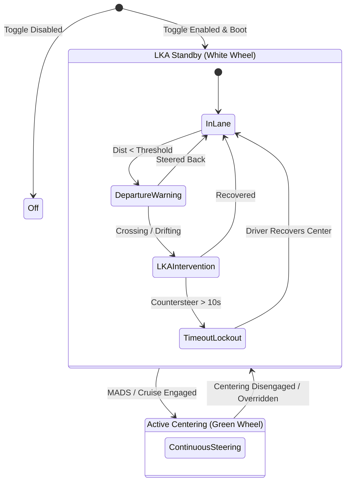
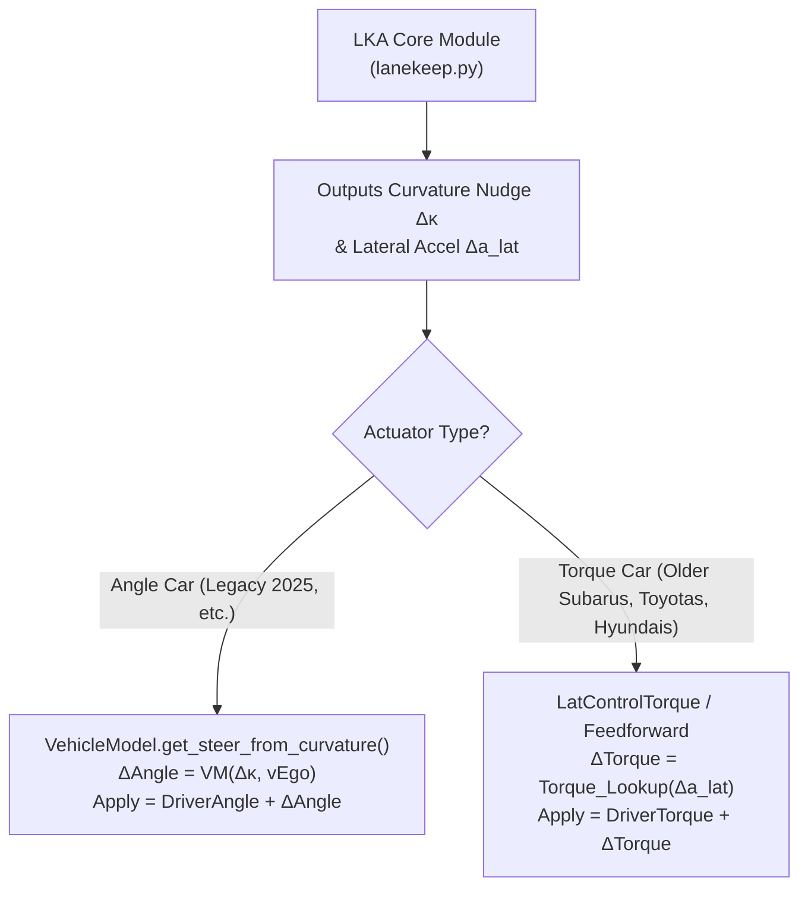
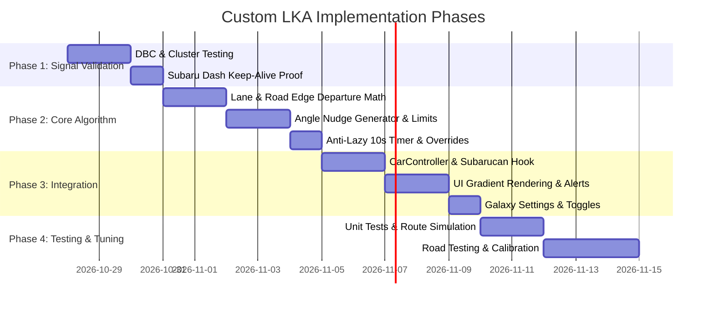

# Architecture & Implementation Plan: Custom Lane Keep Assist (LKA) & Road Departure Mitigation (RDM)

## 1. Executive Summary & Design Vision

This system implements a true **Lane Keep Assist (LKA)** and **Road Departure Mitigation (RDM)** system for StarPilot, distinct from continuous **Lane Centering Assist (LCA / MADS / AOL)**. 

### Core Behaviors
- **Passive In-Lane Feel**: While cruising safely within lane boundaries, openpilot steering effort is **0** (pure unassisted natural steering).
- **Virtual Rumble Strip / Nudge**: When the vehicle drifts near or begins crossing a lane line or road edge, the system applies a smooth, gentle counter-steering nudge back toward lane center.
- **Always-Armed / Persistent**: Off by default, but once enabled in settings, it boots into standby automatically on vehicle start without requiring manual MADS/AOL engagement each drive.
- **Hierarchy with Centering**: When active centering (MADS, AOL, or stock OP cruise) is driving, centering takes full authority. When centering is disengaged, in standby, or temporarily overridden by the driver, LKA seamlessly steps in as guard duty.
- **OEM Subaru Cluster Integration**: Retains the factory dash screen active (avoiding blank screen on boot), shows white standby vs green active steering wheel icons, dynamically draws left/right lane lines as detected by the vision model, and shifts lane line colors/blinks during active intervention.

### 1.1 Complete System Lifecycle & Engagement Walkthrough
The system is explicitly structured around an intuitive, safety-compliant driver experience that guarantees lateral control is never commanded without driver intent:

1. **Vehicle Ignition & Startup**:
   - Driver starts car: Factory instrument cluster boots up, showing the EyeSight LKAS screen with the vehicle model silhouette and distance bars.
2. **openpilot Boot & Dash Persistence**:
   - openpilot finishes booting and transmits `LKAS_ACTIVE = 1` in `ES_LKAS_State` (`0x322`).
   - The LKAS dash screen remains awake and visible (never disappearing or turning blank).
3. **Passive LKA / RDM Armed (Pre-Engagement)**:
   - Steering wheel icon is **White** (`LKAS_Dash_State = 1`).
   - Lane lines on the cluster dynamically appear and disappear based on openpilot's visual lane detection confidence (`hud_control.leftLaneVisible` / `rightLaneVisible`).
   - Driver has 100% natural, unassisted manual steering control. Openpilot does NOT center.
   - If the vehicle drifts near a boundary above the configurable activation floor (default $25\,\text{mph}$, selectable $15 - 45\,\text{mph}$, with hysteresis buffer down to $12\,\text{mph}$), LKA applies a gentle counter-steer nudge back into the lane with visual alert.
4. **MADS / Active Lane Centering Engagement**:
   - Driver presses the steering wheel Cruise button or Lane Centering button.
   - Active lane centering (MADS/AOL) engages with explicit driver consent (fully compliant with openpilot safety rules).
   - Steering wheel icon turns **Green** (`LKAS_Dash_State = 2`).
   - Lane lines remain solid white (`LKAS_Left/Right_Line_Visible = 1`).
   - openpilot actively centers the vehicle in the lane.
5. **Driver Manual Override During Centering**:
   - Driver steers against openpilot (e.g. avoiding road debris).
   - Steering wheel icon turns **White** (`LKAS_Dash_State = 1`).
   - Driver has full manual control without disengaging the system.
   - When the driver centers and releases, the icon smoothly transitions back to **Green** (`LKAS_Dash_State = 2`).
6. **Stock Longitudinal Independence**:
   - Driver sets cruise speed and follows vehicles: Stock EyeSight continues managing longitudinal control (ACC speed, headway bars, lead vehicle tracking) independently without openpilot longitudinal interference.
7. **Independence from Actuator Authority**:
   - `LKAS_ACTIVE` on message `0x322` (`ES_LKAS_State`) is exclusively a cluster display command. It does not command any torque, angle, or request bit to the EPS rack (which is handled separately on `0x124` `ES_LKAS_ANGLE`).
   - Keeping `LKAS_ACTIVE = 1` keeps the cluster screen awake without causing unintentional lateral engagement or altering MADS/AOL behavior.

---

## 2. Subaru Dash & Cluster CAN Reverse Engineering

The signals below have been **empirically validated against ground-truth CAN logs from pure stock Subaru EyeSight driving**:

| Signal Name | Message | Bits | Values / Semantics | Our Usage in Custom LKA |
| :--- | :--- | :---: | :--- | :--- |
| **`LKAS_ACTIVE`** | `0x322` | 1 | `0 = Inactive`, `1 = Active Display` | **Always set to `1`** as soon as openpilot boots up so the car's dash screen remains awake and State 1 is eliminated. |
| **`LKAS_Dash_State`** | `0x322` | 2 | `0 = Off` `1 = Ready (White Wheel)` `2 = Active (Green Wheel)` | **`0`**: System disabled or shifted out of Drive. **`1` (White Wheel)**:   - Driver manual override during active centering.   - Standby when active centering is OFF but passive LKA/RDM is armed/monitoring. **`2` (Green Wheel)**:   - Active lane centering (MADS/AOL) while driving.   - Stopped at red light / standstill in Drive with active centering engaged. |
| **`LKAS_Left_Line_Visible`** | `0x322` | 2 | `0 = Off` `1 = Solid White` `2 = Hollow Outline` `3 = Amber / Yellow` | **`0`**: Line faded / not seen by OP model (`prob < 0.35`). **`1`**: Line clearly tracked (`prob >= 0.50`) — standard solid white lines in both active and standby. **`2`**: Hollow black outlines (unused). **`3`**: **Amber / Yellow** — active during Lane Keep countersteer nudges and departure alerts! |
| **`LKAS_Right_Line_Visible`**| `0x322` | 2 | `0 = Off` `1 = Solid White` `2 = Hollow Outline` `3 = Amber / Yellow` | Same as Left Line. |
| **`LKAS_Left_Line_Light_Blink`** | `0x322` | 1 | `0 = Solid`, `1 = Blinking` | **`1`** during active left departure warning. |
| **`LKAS_Right_Line_Light_Blink`**| `0x322` | 1 | `0 = Solid`, `1 = Blinking` | **`1`** during active right departure warning. |
| **`LKAS_Alert_Msg`** | `0x322` | 3 | `0 = None` `1 = "Keep Hands on Steering Wheel"` `7 = Persistent Warning Indicator` | **Small LKAS meter screen** (between gauges):   - Set to `1` on initial driver monitoring warning for silent prompt on small screen without interrupting big screen. |
| **`LKAS_State_Infotainment`**| `0x323` | 3 | `0 = None` `2 = Obstacle Detected (FCW)` `3 = "Keep Hands on Steering Wheel"` | **Big central infotainment screen popup**:   - Set to `3` when steering limits are exceeded or driver monitoring escalates to high severity. |
| **`LKAS_Alert`** | `0x322` | 5 | `0 = None` `11 = LDW_Right` `12 = LDW_Left` `25 = DM Warning Chime` `28 = Hands-Off Escalating Chime` `30 = Critical Disengagement Alarm` | Car cluster audible chimes: gentle nudges send `0` (silent); true line crossing sends `11`/`12`; escalating hands-off sends pulsed `28` and continuous `30`. |
| **`ES_LKAS_Alert`** | `0x3C4` | 48 | Windshield HUD reflection LEDs & chimes | `0c0006000000` = Left departure amber flash. `0b0005000000` = Right departure amber flash. `1c0704000000` = Hands-off warning pulse. `1e0030000000` = Hands-off critical disengage tone. |

### 2.1 Complete Component & Scenario State Matrix

The table below breaks down the exact state of every visual, audible, and steering component across all driving scenarios, clearly delineating **Stock EyeSight Native Pass-Through** vs. **StarPilot Actions**:

| Scenario / Trigger | Steering Wheel Icon | Left Line Color | Right Line Color | Small Cluster Screen (`LKAS_Alert_Msg`) | Big Infotainment Screen (`LKAS_State_Infotainment`) | Audible Chimes (`LKAS_Alert` / `0x3C4`) | Steering Actuator (`0x124`) |
| :--- | :---: | :---: | :---: | :---: | :---: | :---: | :---: |
| **1. Car Startup / Key-On** *(openpilot still booting)* | Off / None | Off (`0`) | Off (`0`) | None (`0`) | None (`0`) | Silent (`0`) | Off (`req=0`) |
| **2. OP Ready / LKA Standby** *(Natural driving, both lines visible)* | **White** (`1`) | **Solid White** (`1`) | **Solid White** (`1`) | None (`0`) | None (`0`) | Silent (`0`) | Off (`req=0`, 100% manual) |
| **3. OP Ready / LKA Standby** *(Right line faded or intersection)* | **White** (`1`) | **Solid White** (`1`) | **Off** (`0`) | None (`0`) | None (`0`) | Silent (`0`) | Off (`req=0`, 100% manual) |
| **4. Sharp Corner / Blinker Gate** *(Turning $> 45^\circ$, apexing, or signaling)* | **White** (`1`) | **Off** (`0`) | **Off** (`0`) | None (`0`) | None (`0`) | Silent (`0`) | Off (`req=0`, lines turn off during active turn) |
| **5. Passive LKA Nudge Active** *(Drifting near left line boundary)* | **White** (`1`) | **Yellow / Amber** (`3`) | **Solid White** (`1`) | None (`0`) | None (`0`) | **Silent** (`0`) *(Visual yellow line only; zero chimes!)* | **Gentle Countersteer** *(Light, easily overridable spring)* |
| **6. True Lane Departure** *(Vehicle actually crosses line)* | **White** (`1`) | **Yellow / Amber** (`3`) | **Solid White** (`1`) | **Native EyeSight Dash LDW Alert** | None (`0`) | **100% Native EyeSight Pass-Through** *(Stock EyeSight chime + HUD flash; OP injects zero chimes!)* | **LKA Finishing Nudge** *(Easily overridable)* |
| **7. LKA Approaching Timeout** *(Continuous nudge near ~10s)* | **White** (`1`) | **Yellow / Amber** (`3`) | **Solid White** (`1`) | **"Keep Hands on Wheel"** (`1`) | None (`0`) | **Subtle Timeout Chimes** *(Held off if car is already alarming)* | Releasing nudge gradually back to driver |
| **8. RDM Emergency Timeout** *(Off-road ditch drift timing out)* | **White** (`1`) | **Yellow / Amber** (`3`) | **Solid White** (`1`) | **"Keep Hands on Wheel"** (`1`) | Pop-up Warning (`3`) | **Urgent Loud Alarm Tone** *(Held off if car is already alarming)* | Holding edge margin before safety cutoff |
| **9. Active Lane Centering** *(MADS / AOL Engaged & cruising)* | **Green** (`2`) | **Solid White** (`1`) | **Solid White** (`1`) | None (`0`) | None (`0`) | Silent (`0`) | **Active Centering** *(Continuous path tracking)* |
| **10. Manual Override of Centering** *(Driver turns wheel to dodge pothole)* | **White** (`1`) | **Solid White** (`1`) | **Solid White** (`1`) | None (`0`) | None (`0`) | Silent (`0`) | Off (`req=0`, driver has full authority) |
| **11. Red Light Standstill** *(Centering was engaged, stopped in D)* | **Green** (`2`) | **Solid White** (`1` or `0` if blocked) | **Solid White** (`1` or `0` if blocked) | None (`0`) | None (`0`) | Silent (`0`) | Holding / zero angle at stop |
| **12. Driver Monitoring Alert** *(openpilot hands-on-wheel prompt)* | **Green** (`2`) | Solid White (`1`) | Solid White (`1`) | **"Keep Hands on Wheel"** (`1`) *(Mirrored on small screen!)* | **"Keep Hands on Wheel" Popup** (`3`) *(Large center display popup)* | Standard openpilot prompt tone | Active Centering |

### 2.2 Alert Arbitration & Conflict Prevention (Car vs. Openpilot)

To prevent visual collisions or conflicting audio signals between the vehicle's native ECUs and openpilot:

1. **Native EyeSight Departure Pass-Through (Zero Duplication)**:
   - When the vehicle crosses over a lane line, the factory Subaru EyeSight cameras independently detect the departure and natively command the dash cluster chime (`LKAS_Alert = 11/12`), meter graphic, and windshield reflection HUD LEDs (`0x3C4`).
   - StarPilot does **not** inject duplicate lane departure alarms, nor does it block the native alerts. They pass through uninhibited.
2. **Absolute Priority Rule (Car Takes Precedence)**:
   - If stock EyeSight is currently alarming about *anything* (incoming `es_lkas_state.LKAS_Alert != 0` for native lane departure, FCW obstacle, pedestrian warning, etc.):
   - All custom StarPilot timeout chimes and alert overrides are **strictly held off / muted**.
   - Signals never clash or talk over each other on the screens or audio bus.
3. **Synchronized Driver Monitoring (Dual-Screen Mirroring)**:
   - When openpilot triggers a driver awareness or steering limit prompt, it sets `LKAS_State_Infotainment = 3` (big center touchscreen) AND simultaneously sets `LKAS_Alert_Msg = 1` (small meter display between gauges). Both screens show the reminder in harmony.
4. **The Only Scenarios Where StarPilot Triggers Custom Alerts**:
   - **LKA 10-Second Anti-Lazy Timeout**: If a driver leans against the boundary and LKA countersteers continuously for approaching 10 seconds without driver input, StarPilot sends a subtle reminder (`LKAS_Alert_Msg = 1` + quiet chime) before smoothly decaying assist. If the car subsequently crosses the line, the native EyeSight departure warning handles it.
   - **RDM Emergency Road Edge Timeout**: If the car drifts toward an unpaved road edge / ditch and RDM countersteering approaches its timeout, StarPilot sounds an urgent warning (only if the car's native alert is not already sounding).

---

## 3. Intervention Detection & Departure Dynamics

### 3.1 Input Sources
From `modelV2` published at 20 Hz:
1. **Lane Lines**: `laneLines[1]` (left) and `laneLines[2]` (right lateral y coordinates at $x=0$, front axle).
2. **Lane Line Probabilities**: `laneLineProbs[1]` and `laneLineProbs[2]`.
3. **Road Edges**: `roadEdges[0]` (left) and `roadEdges[1]` (right lateral y coordinates) with `roadEdgeStds`.
4. **Trajectory & Heading**: Vehicle lateral velocity $v_{lat}$, yaw rate $\dot{\psi}$, and model desire probabilities (`laneChangeLeft`, `laneChangeRight`).

### 3.2 Time-to-Cross (TTC) & Distance Calculation
Rather than only evaluating static distance, the trigger evaluates both:
1. **Lateral Distance to Edge**:
   $$d_{left} = -y_{left} - w_{half}$$
   $$d_{right} = y_{right} - w_{half}$$
   *(where $w_{half} \approx 0.95\,\text{m}$ for vehicle half-width with bumper margin).*
2. **Estimated Time-to-Cross (TTC)**:
   $$\text{TTC} = \frac{d}{\dot{y}_{veh}}$$

### 3.3 Three Multi-Tier Modes
1. **Mode 0: Off**
2. **Mode 1: Road Edge Only** (useful on rural/unstriped roads to prevent ditch/guardrail departures).
3. **Mode 2: Lane Line + Road Edge Fallback** (default):
   - **Primary Guard**: Monitored against lane lines.
   - **Secondary Guard (RDM)**: If lane lines are missing, or if departure continues past lane line, road edge intervention triggers with higher authority ($+30\%$ steering rate limit) and independent buzzer alert.

### 3.4 Operating Speed Window & Configurable Activation Floor
1. **Stock Subaru EyeSight Baseline**:
   - Stock Subaru EyeSight LKA does not begin tracking lines or offering boundary nudges until reaching **$\approx 37 - 38\,\text{mph}$ ($60\,\text{km/h}$)**.
   - Below 37 mph, the factory instrument cluster keeps the lane line graphics inactive/grey.
2. **User-Selectable Activation Speed (`LaneKeepMinActivationSpeed`)**:
   - Instead of hardcoding a high threshold, StarPilot will provide a configurable setting in the UI:
     - **Configurable Range**: **$15\,\text{mph}$ to $45\,\text{mph}$** (in $1\,\text{mph}$ or $5\,\text{mph}$ increments).
     - **Default Recommendation**: **$25\,\text{mph}$** (providing suburban road protection).
     - **Absolute Hard Floor**: **$15\,\text{mph}$ ($24\,\text{km/h}$)**.
3. **Rationale for the $15\,\text{mph}$ Floor**:
   - Below 15 mph (parking lots, driveways, tight residential streets, and 90° intersection turns), drivers frequently and deliberately cut across painted lines or pull near curbs.
   - Setting an absolute floor of 15 mph guarantees the system never initiates an unwanted nudge while turning at low speeds or maneuvering in tight spaces.
4. **Hysteresis Buffer (Preventing Flapping)**:
   - A dynamic $3 - 4\,\text{mph}$ hysteresis prevents rapid toggling when hovering near local speed limits:
     $$v_{deactivate} = \max(v_{activate} - 4\,\text{mph}, 12\,\text{mph})$$
   - *Example A (Set to 25 mph)*: Arms nudges at $\ge 25\,\text{mph}$, smoothly disarms when dropping below $21\,\text{mph}$.
   - *Example B (Set to 15 mph minimum)*: Arms nudges at $\ge 15\,\text{mph}$, smoothly disarms when dropping below $12\,\text{mph}$.
5. **Cluster Line Visibility Synchronization**:
   - When driving above $v_{activate}$ with lane detection confidence, the cluster lines show solid white (`1`).
   - When vehicle speed dips below $v_{deactivate}$, the lines smoothly fade off (`0`), while the steering wheel remains in standby white (`1`) so the cluster never collapses into State 1.

---

## 4. Steering Actuation & Anti-Centering Protection

### 4.1 Universal Nudge Architecture (Vehicle-Agnostic Curvature)
To ensure this system is cleanly upstreamable into "stock" StarPilot or openpilot across **all brands and actuator types (both Angle and Torque cars)**, the LKA module does not hardcode raw angles.

Instead, it uses openpilot's universal lateral control currency: **Desired Curvature ($\Delta \kappa$, in $\text{m}^{-1}$)** and **Desired Lateral Acceleration ($\Delta a_{lat} = v_{ego}^2 \cdot \Delta \kappa$, in $\text{m/s}^2$)**.

1. **The Universal Boundary Spring**:
   Calculate the required corrective curvature:
   $$\Delta \kappa = K_p \cdot (d_{thresh} - d) + K_d \cdot \dot{d}$$
   Clamped to a gentle acceleration ceiling:
   $$\Delta a_{lat, max} \approx 0.8 \text{ to } 1.2\,\text{m/s}^2$$
2. **Translation to Car Actuators**:
   * **For Angle Cars (e.g. 2025 Subaru Legacy, Toyota LTA, Nissan ProPILOT)**:
     $$\Delta \theta = \text{math.degrees}(\text{VM.get_steer_from_curvature}(\Delta \kappa, v_{ego}, 0.0))$$
     $$\text{Target Angle} = \theta_{driver} + \Delta \theta$$
   * **For Torque Cars (e.g. Preglobal / 2015-2019 Subarus, Honda, Hyundai EPS)**:
     $$\Delta \tau = \text{lat\_accel\_to\_torque}(\Delta a_{lat})$$
     $$\text{Target Torque} = \text{clip}(\Delta \tau, -\tau_{nudge\_max}, \tau_{nudge\_max})$$
3. **Smooth S-Curve Envelope**:
   Whether commanding angle or torque, the correction is shaped with a smooth S-curve envelope ($100\text{ms}$ rise/fall) so neither the angle rack nor the torque motor ever steps or snaps.

### 4.2 Driver Override, Cornering Gates & Turn Signal Suppression
- **Steering Wheel Angle Suppression Gate ($|\theta_{steer}| \ge 45^\circ$)**:
  - If the physical steering wheel angle exceeds **$45^\circ$** (or speed-scaled threshold), all LKA boundary nudges are **automatically suppressed**.
  - **Rationale**: When the steering wheel is turned $> 45^\circ$, the driver is actively engaged in a sharp curve, roundabout, turning lane, or 90° intersection maneuver. They are deliberately steering the car, not unintentionally drifting due to inattention. Suppressing assist past $45^\circ$ guarantees the car never fights active cornering.
- **Inside-Curve Apex Cut Smoothing**:
  - When negotiating sweeping highway curves, drivers naturally and intentionally clip or drift toward the *inside* painted line to smooth out lateral Gs (apex cutting).
  - StarPilot compares vehicle yaw rate and road curvature ($\kappa_{road}$). If the vehicle is actively following the curve and drifting toward the *inside* line, LKA temporarily widens the departure boundary by $0.25\,\text{m}$ to avoid unwanted nuisance nudges through curves.
- **Maximum Corrective Authority Clamp**:
  - The maximum angle delta that LKA can ever command is strictly clamped:
    $$\Delta \theta_{nudge\_max} \le 12^\circ - 15^\circ$$
  - This ensures LKA can never jerk the wheel or command extreme steering, maintaining a gentle, predictable boundary guide.
- **Turn Signal Suppression (Intentional Lane Changes)**:
  - If either the left or right blinker is active (`CS.out.leftBlinker` or `CS.out.rightBlinker`), LKA assist on that side is **immediately suppressed**.
  - A post-blinker cooldown (e.g. 2.0 seconds after the stalk auto-cancels) allows completion of the lane change without any counter-steering resistance.
  - This matches OEM Subaru EyeSight behavior and actively reinforces good driving habits.
- **Steering Torque Override (Light Hand Pressure)**:
  - If the driver applies steering torque towards or through the line ($> 0.5 - 0.6\,\text{Nm}$, gentle finger pressure), the intervention is immediately suspended.
  - Substantially lighter than the active centering override torque ($1.5 - 2.0\,\text{Nm}$), ensuring you can guide the car anywhere with zero fight.
- **Visual Line Suppression Feedback (Cluster Sync)**:
  - Whenever LKA is suppressed (due to steering wheel angle $\ge 45^\circ$, sharp corner apexing, active turn signal, or speed below floor), the corresponding dash cluster line(s) **turn OFF (`0`)**.
  - As soon as the maneuver finishes (wheel straightens back $< 45^\circ$, blinker cancels, curve straightens), the lines cleanly illuminate back in solid **WHITE (`1`)**.
  - This provides clear, intuitive visual confirmation on the instrument cluster that LKA is intentionally standing down while you actively steer, and seamlessly confirms when guard duty re-arms.

### 4.3 Anti-Lazy-Centering Timer, Progressive Warning & Alert Suppression
- **Core Principle: Zero Alert Fatigue for Gentle Boundary Nudges**:
  - A major flaw of poorly tuned OEM systems is excessive beeping for routine driving.
  - During normal gentle in-lane boundary nudges, the system operates **silently and subtly**:
    - **No audible chimes**.
    - **No cluster alert text or buzzer**.
    - The active boundary line turns **Yellow / Amber (`3`)** on the Subaru cluster, and the Comma screen displays the amber boundary gradient.
  - Audible alarms, cluster warnings, and windshield HUD alerts are strictly reserved for genuine safety threats:
    1. **Anti-lazy timer escalations** (driver leaning against the system approaching 10s).
    2. **True line crossing / high-velocity departures** (100% handled natively by Subaru EyeSight; StarPilot does not duplicate or block).
    3. **Road Departure Mitigation (RDM)** towards unpaved edges/ditches timing out.

- **Progressive Alert & Timeout Flow**:
  - A continuous intervention timer increments while $|\Delta \kappa_{corr}| > 0$.
  - **Stage 1 (Normal Gentle Nudge, 0s – 8s)**:
    - Purely passive steering adjustment + line turns **Yellow (`3`)** on cluster + amber boundary glow on Comma screen.
    - Zero chimes, zero cluster alert text (`LKAS_Alert = 0`, `LKAS_Alert_Msg = 0`).
  - **Stage 2 (Progressive Warning, 8s – 10s, ~2s before cutoff)**:
    - Small cluster screen displays stock **"Keep Hands on Wheel"** warning (`LKAS_Alert_Msg = 1`).
    - Emits subtle timeout chime (quiet 100ms chime pulse or Comma prompt chime). Held off if native car alert is already sounding.
  - **Stage 3 (Cutoff & Lockout, > 10s)**:
    - Standard lane line countersteer smoothly decays to 0 to prevent lazy-centering abuse.
    - If the vehicle crosses the line due to driver inaction, **Subaru EyeSight natively triggers the factory Lane Departure Warning** (audible chime, dash warning, and flashing windshield HUD reflection LEDs). StarPilot allows this through cleanly without duplicate alarms.
    - Lockout clears as soon as the driver applies steering torque ($> 0.6\,\text{Nm}$) and re-centers the vehicle.

### 4.4 Tiered Road Edge Mitigation (RDM) — The Physical Guardian of Last Resort
- **Independent Thresholds & Extended Timeout**:
  - Road Edge Mitigation has its own independent timeout window (up to **20.0 seconds** total).
  - Even if the standard Lane Line assist has timed out into Stage 3, the **Road Edge guardian remains armed in the background**.
  - If the vehicle drifts past the painted lane marker toward the physical road boundary (grass, ditch, barrier, curb), RDM executes a firmer countersteer intervention to keep tires on the road surface.
  - If RDM intervention approaches its timeout without driver takeover, StarPilot activates an **urgent, louder chime and big screen takeover** (`LKAS_State_Infotainment = 3` + continuous alarm tone, held off if native car alert is already active).
  - This precisely mirrors Subaru EyeSight's multi-layered emergency departure intervention philosophy while ensuring driver attentiveness is maintained.

---

## 5. User Interface & Visuals

### 5.1 On-Road Comma Screen Visuals
- **In-Scene Perspective Line Attachment (Not Screen Edge)**:
  - The visual gradient attaches directly to the **3D on-road projected line/edge polygon** (`lane_line.projected_points` and `road_edge.projected_points`), tracking the curvature and perspective of the physical asphalt ahead.
  - It does **not** draw as a static vignette or bezel on the flat edge of the glass display. It appears naturally painted onto the road surface itself.
- **Two-Tone Color Differentiation (Amber for Lines, Red for Road Edges)**:
  - **Lane Line Assist (LKA)**: Renders in a glowing **Amber / Gold** (`rl.Color(255, 185, 0)`), perfectly harmonizing with the Subaru dash cluster's amber line state (`3`).
  - **Road Departure Mitigation (RDM)**: Renders in a vibrant **Neon Red** (`rl.Color(255, 35, 35)`), providing an unmistakable visual distinction when approaching an unpaved shoulder, grass, curb, or ditch.
- **Sensitivity-Scaled Gradient Widths**:
  - The metric physical width of the inward-feathering glow directly reflects your chosen sensitivity profile:
    - **Late**: Narrow ribbon ($\approx 0.15\,\text{m} / 6\,\text{in}$), tightly hugging the boundary.
    - **Normal (Default)**: Balanced ribbon ($\approx 0.30\,\text{m} / 12\,\text{in}$), feathering smoothly toward the lane center.
    - **Proactive**: Generous ribbon ($\approx 0.45\,\text{m} / 18\,\text{in}$), visually illustrating the broader safety cushion.
- **Dynamic Proximity & Intervention Glow**:
  - The gradient's opacity and brightness scale dynamically with tire proximity ($0\% \to 100\%$) and countersteer torque, creating a responsive "glow" effect as you drift closer.
- **Status Indicator**:
  - On the UI top widget bar or steering wheel icon, display a distinct LKA indicator (e.g. white steering wheel icon in standby, amber icon during active nudge).

### 5.2 Settings in Galaxy & Device Layout
Add to `starpilot/common/assets/device_settings_layout.json` and `common/params_keys.h`:
- `LaneKeepAssistMode`: `0: Off`, `1: Road Edge Only`, `2: Lane Line + Road Edge`
- `LaneKeepSensitivity`: `0: Late (Cross Line)`, `1: Normal`, `2: Proactive (Early)`
- `LaneKeepAudibleAlert`: `bool` (whether to trigger stock Subaru cluster chime or Comma chime during nudge)

---

## 6. Implementation Breakdown & Milestones

### Milestone Details
1. **Phase 1: Cluster & CAN Signal Validation**
   - Verify on the 2025 Legacy that transmitting `LKAS_ACTIVE = 1` and `LKAS_Dash_State = 1` keeps the instrument cluster screen awake with a white steering wheel when openpilot is not centering.
   - Verify `LKAS_Left_Line_Visible = 1/2/3` changes the cluster lane colors as documented.
2. **Phase 2: LKA Daemon / Planner Module (`lanekeepd.py` or `controls/lib/lanekeep.py`)**
   - Consume `modelV2` lane lines, road edges, and vehicle telemetry.
   - Calculate lateral margins, TTC, 10s anti-lazy timer, and intervention requests.
3. **Phase 3: Controller Hookup (`carcontroller.py`)**
   - Merge LKA angle nudge into `lateral_angle` when `CC.latActive` is False.
   - Feed lane line visibility states into `create_es_lkas_state`.
4. **Phase 4: Comma UI Shader / Model Renderer**
   - Add the amber gradient polygon rendering to `model_renderer.py`.
5. **Phase 5: Settings & Unit Testing**
   - Add params to Galaxy UI and write full pytest test suite in `opendbc_repo/opendbc/car/subaru/tests/test_lanekeep.py`.

---

## 7. Future Expansion Roadmap (Post-Base System)

Once the core LKA and RDM system is deployed, validated, and road-tuned, the following advanced capabilities can be layered on top:

1. **Active Blind Spot Avoidance (BSI Nudge)**:
   - Integrate with Subaru radar / V-ASM (`CS.out.leftBlindspot` / `CS.out.rightBlindspot`).
   - Trigger earlier (~0.35m from line) with firmer countersteer if drifting toward an occupied adjacent lane.
2. **Distraction-Adaptive Sensitivity (Driver Monitoring)**:
   - Link with `driverStateV2` awareness status.
   - When eyes are on the road: relaxed, OEM-style late intervention.
   - When eyes are distracted/off-road: temporarily widen departure buffer by ~0.2m to catch drift early.
3. **Road Curvature & Curve Apex Smoothing**:
   - Utilize model road curvature ($\kappa$) and vehicle yaw rate.
   - Prevent false nudges when the driver intentionally cuts or apexes the inside line through highway curves.
4. **Construction Zone / Faded Paint Guard**:
   - When lane line probabilities drop below 35% or conflicting stripes are detected, smoothly decay paint-line tracking and prioritize Road Edge boundaries to prevent jitter.
5. **Steering Wheel Button Quick-Toggle**:
   - Map a double-tap or long-press of the stock Subaru Lane Keep button to cycle LKA modes (*Off* / *Road Edge Only* / *Full LKA*) without touching the screen.
6. **Customizable Personality / Feedback Profiles**:
   - Galaxy toggles for feedback style: *Subaru OEM Chimes*, *Stealth / Silent (Steer Only)*, or *Comma Audio Tones*.

---

## 8. Lateral Engagement Smoothing & Low-Speed Authority

While exploring the Lane Keep architecture, low-speed handling and engagement transitions will be refined to eliminate any abrupt behavior:

### 8.1 Takeoff Jerk Elimination & Engagement Smoothing
1. **Root Cause of Takeoff Jerk**:
   - While stopped or disengaged, the commanded angle history (`apply_steer_last`) can diverge from the physical steering wheel angle (`CS.out.steeringAngleDeg`).
   - When the vehicle moves forward and crosses the minimum engagement speed, openpilot abruptly commands the delta between the old stored state and the new path target, creating a noticeable jerk.
2. **Zero-Discontinuity Seeding**:
   - Continuously update `apply_steer_last = CS.out.steeringAngleDeg` whenever steering is inactive or vehicle is at standstill.
   - On the rising edge of `lkas_active`, the initial target angle starts exactly equal to the physical steering angle with zero step delta.
3. **Soft Ramp-In Filter**:
   - Apply a 300–500ms progressive blend (soft cosine or S-curve ramp) transitioning from the driver's current wheel position to the model's desired path curvature upon launch.

### 8.2 Low-Speed & Standstill Steering Authority
1. **Creep Speed Extension**:
   - Lower `_LEGACY_2025_MADS_MIN_SPEED` from $0.447\,\text{m/s}$ (1.0 mph) down toward creep threshold so steering remains continuous through slow rolling stops and stop-and-go crawls.
2. **Standstill Steering Evaluation (`steerAtStandstill = True`)**:
   - Evaluate setting `ret.steerAtStandstill = True` on the 2025 Legacy angle platform.
   - Allows holding active lane angle while stationary and eliminates the disengage/re-engage cycle at stoplights entirely.

---

## 9. EyeSight Stereoscopic Virtual Radar Integration (`radard.py` Sensor Fusion)

Investigation and architecture for leveraging Subaru EyeSight's stereoscopic camera target tracking (`ES_Distance` / `ES_Status`) as a virtual radar interface within openpilot's perception stack:

### 9.1 Current Baseline: Comma Vision Estimations vs. EyeSight
1. **Current Comma Display Mechanism**:
   - On the Comma screen, the lead vehicle visual (yellow chevron/triangle with relative speed and distance metrics) is driven by `radard.py` publishing `radarState.leadOne` and `leadTwo`.
   - On Subaru platforms today, `radarUnavailable = True` (empty radar interface), meaning `radard` relies 100% on openpilot's neural network vision estimations (`modelV2.leadsV3`).
   - The Comma's wide-angle 3X vision model frequently spots silhouette and brake lights of lead cars far in advance (80m–120m+), earlier than EyeSight's HUD/cluster target lock dot.
2. **Subaru EyeSight Stereoscopic Characteristics**:
   - EyeSight utilizes dual calibrated stereoscopic cameras to calculate direct geometric disparity (parallax) rather than monocular optical scale estimation.
   - Once within acquisition range (~60m–80m), EyeSight provides true ground-truth distance ($d_{rel}$), precise doppler-equivalent relative velocity ($v_{rel}$), and relative acceleration ($a_{rel}$).
   - Independent of pitch bounce, cresting hills, and road texture artifacts that occasionally cause monocular depth drift.

### 9.2 Seamless Two-Tier Sensor Fusion Architecture
1. **Preserving Early Detection (Vision-to-Radar Handshake)**:
   - When a virtual `RadarInterface` is implemented for Subaru, `radard` does **not** discard vision estimations.
   - **Phase A (Long Range, >60–80m)**: EyeSight has not yet acquired or locked target. `radard` detects `modelProb > 0.35` and immediately displays the lead chevron using Comma vision depth estimates.
   - **Phase B (Mid/Close Range, <60–80m)**: EyeSight locks on and emits stereoscopic tracks via CAN (`ES_Distance` / lead signals). `radard`'s association logic (`track_matches_vision`) matches the physical track with the vision candidate.
   - **Phase C (Seamless Track Promotion)**: The track transitions to `radar = True`. The Kalman filter absorbs EyeSight's millimeter-grade parallax distance and velocity, stabilizing distance readouts and eliminating follow-distance oscillation.
   - **Phase D (Dropout Fallback)**: If EyeSight loses track around an acute curve or road crest, `radard` seamlessly falls back to vision lead estimation without flickering or dropping the UI lead triangle.

### 9.3 CAN Signals & Implementation Roadmap
1. **Message Reverse Engineering (Pure EyeSight Route Extraction)**:
   - Identify candidate lead distance and velocity bytes in `ES_Distance` (`0x221` / `545`), `ES_Status` (`0x222` / `546`), and undocumented stereo frames.
   - Correlate logged CAN bytes against physical follow distances and dashboard distance bar increments.
2. **Subaru `RadarInterface` Module**:
   - Implement `opendbc/car/subaru/radar_interface.py` inheriting from `RadarInterfaceBase`.
   - Populate `RadarData` tracks (`dRel`, `yRel`, `vRel`, `measured = True`) from parsed EyeSight CAN packets.
3. **Safety & Longitudinal Separation**:
   - In stock cruise mode (PCM cruise enabled, openpilot lateral-only / MADS), this data enhances situational awareness, HUD lead graphics, and StarPilot adjacent-lane cut-in detection.
   - Lays the ground-truth sensor foundation for future openpilot longitudinal control on Subaru Global Gen2 without requiring external radar hardware.

