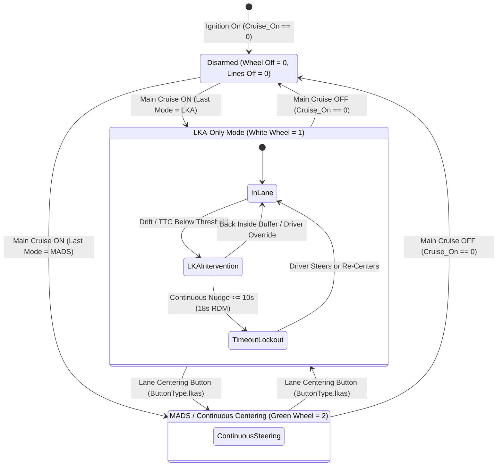
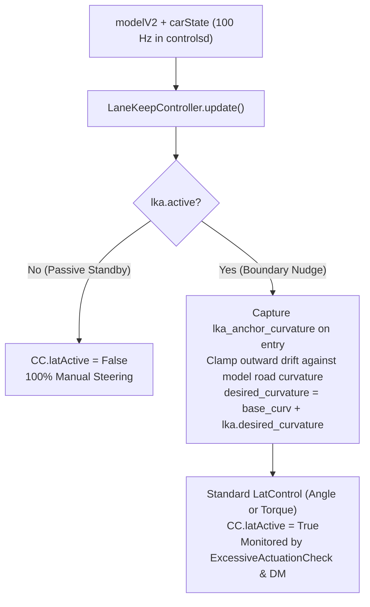
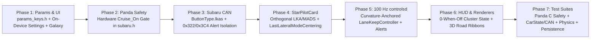

# Architecture & Implementation Plan: Custom Lane Keep Assist (LKA) & Road Departure Mitigation (RDM)

## 1. Executive Summary & Design Vision

This system implements a comma-safety-compliant **Lane Keep Assist (LKA)** and **Road Departure Mitigation (RDM)** system for StarPilot, operating alongside continuous **Lane Centering Assist (MADS / AOL)** as two orthogonal lateral modes gated by the vehicle's hardware **Main Cruise (`Cruise_On`)** switch.

### Core Behaviors
- **Hardware Master Safety Gate (`Cruise_On`)**: All lateral steering authority (both LKA nudges and MADS/AOL continuous centering) is strictly gated by `ES_DashStatus.Cruise_On == 1` (`0x321`) inside STM32 Panda safety (`acc_main_on`) and software. When `Cruise_On == 0` (or out of Drive), steering output is zero and both the cluster steering wheel icon and lane lines are completely hidden (`0`).
- **Orthogonal Longitudinal × Lateral Mode Selection**:
  - **Main Cruise Button**: Arms or disarms the lateral system (`Cruise_On: 0 <-> 1`). If ACC is currently engaged, the first press cancels ACC while keeping the chosen lateral mode active; a second press turns `Cruise_On` off and disarms all lateral control.
  - **Lane Centering Button (`ButtonType.lkas`)**: Toggles cleanly between **LKA-Only** (White wheel `1`) and **MADS / Continuous Centering** (Green wheel `2`) whether ACC is OFF or ON.
  - **Persistent Last-Mode Memory (`LastLateralModeCentering`)**: StarPilot remembers which lateral mode was used last across ignition cycles and automatically restores LKA-Only or MADS/Centering the first time Main Cruise is armed on a new drive.
- **Passive In-Lane Feel in LKA-Only**: While cruising safely within lane boundaries in LKA-Only mode, openpilot steering effort is **0** (100% natural manual steering).
- **Virtual Rumble Strip / Nudge**: When drifting near or crossing a lane line or road edge above `LaneKeepMinActivationSpeed`, `controlsd` anchors to the current vehicle/road curvature and commands a gentle, rate-limited corrective curvature nudge (`CC.latActive = True`, monitored by `ExcessiveActuationCheck` and active Driver Monitoring).
- **OEM Subaru Cluster & EyeSight Alert Isolation**: Dynamically drives `0x322` (`ES_LKAS_State`) cluster wheel/line states while suppressing background stock EyeSight centering and hands-off alerts on both `0x322` and `0x3C4` (`ES_LKAS_Alert`), preserving stock Forward Collision Warning (FCW).

### 1.1 Orthogonal Longitudinal × Lateral Mode Matrix (While `Cruise_On == 1` in Drive)

| Longitudinal State | Lateral Mode (`LastLateralModeCentering`) | Steering Behavior | Cluster Wheel Icon (`LKAS_Dash_State`) | Cluster Lane Lines (`LKAS_*_Line_Visible`) | Button Transitions |
| :--- | :--- | :--- | :---: | :---: | :--- |
| **ACC OFF** | **LKA-Only (`False`)** | 100% manual steering in-lane; gentle counter-steer nudge only near boundary (`>= LaneKeepMinActivationSpeed`) | **White (`1`)** | **`1` White** when visible & `>= minSpeed`; **`3` Amber** on active nudge; **`0` Off** below floor / turn / blinker | **Lane Centering btn** -> `ACC OFF + MADS` **SET/-** -> `ACC ON + LKA-Only` **Main Cruise btn** -> `Disarmed (0)` |
| **ACC OFF** | **MADS / Centering (`True`)** | Continuous openpilot lane centering without ACC | **Green (`2`)** moving (`1` White at standstill or driver override) | **`1` White** when tracked (`0` if untracked) | **Lane Centering btn** -> `ACC OFF + LKA-Only` **SET/-** -> `ACC ON + MADS` **Main Cruise btn** -> `Disarmed (0)` |
| **ACC ON** | **LKA-Only (`False`)** | Stock EyeSight ACC controls speed; driver steers manually with LKA boundary nudges | **White (`1`)** | **`1` White** / **`3` Amber** on nudge | **Lane Centering btn** -> `ACC ON + MADS` **Cancel / Main Cruise (1st press)** -> `ACC OFF + LKA-Only` |
| **ACC ON** | **MADS / Centering (`True`)** | Full highway assist: Stock EyeSight ACC + continuous openpilot lane centering | **Green (`2`)** moving (`1` White at standstill or override) | **`1` White** when tracked | **Lane Centering btn** -> `ACC ON + LKA-Only` **Cancel / Main Cruise (1st press)** -> `ACC OFF + MADS` |

---

## 2. Subaru Dash & Cluster CAN Reverse Engineering

The signals below have been **empirically validated against ground-truth CAN logs from pure stock Subaru EyeSight driving**:

| Signal Name | Message | Bits | Values / Semantics | Usage in StarPilot LKA + MADS |
| :--- | :---: | :---: | :--- | :--- |
| **`Cruise_On`** | `0x321` | 1 | `0 = Main Off`, `1 = Main Armed` | Hardware Panda (`acc_main_on`) & software master safety gate. When `0`, zero steering torque/angle can ever reach `Bus.main` and cluster icons/lines are `0`. |
| **`LKAS_ACTIVE`** | `0x322` | 1 | `0 = Inactive`, `1 = Active Display` | Kept at `1` so the instrument cluster vehicle/headway display never collapses to a blank screen, while `LKAS_Dash_State` and line bits control icon visibility. |
| **`LKAS_Dash_State`** | `0x322` | 2 | `0 = Hidden` `1 = Ready (White Wheel)` `2 = Active (Green Wheel)` | **`0`**: Hidden whenever `Cruise_On == 0` or out of Drive. **`1` (White Wheel)**: LKA-Only armed (standby or active nudge), MADS standstill, or MADS manual driver override. **`2` (Green Wheel)**: Active MADS / Continuous Centering while moving. |
| **`LKAS_Left_Line_Visible`** | `0x322` | 2 | `0 = Off` `1 = Solid White` `2 = Hollow Outline` `3 = Amber / Yellow` | **`0`**: Hidden whenever `Cruise_On == 0`, out of Drive, untracked (`prob < 0.35`), or gated in LKA-Only (`< minSpeed`, `\|steer\| >= 45°`, blinker). **`1`**: Solid white when tracked. **`3`**: **Amber / Yellow** during active LKA/RDM nudges and departure alerts. |
| **`LKAS_Right_Line_Visible`**| `0x322` | 2 | `0 = Off` `1 = Solid White` `2 = Hollow Outline` `3 = Amber / Yellow` | Same as Left Line. |
| **`LKAS_Left_Line_Light_Blink`** | `0x322` | 1 | `0 = Solid`, `1 = Blinking` | **`1`** during active left departure warning (`hudControl.leftLaneDepart`). |
| **`LKAS_Right_Line_Light_Blink`**| `0x322` | 1 | `0 = Solid`, `1 = Blinking` | **`1`** during active right departure warning (`hudControl.rightLaneDepart`). |
| **`LKAS_Alert_Msg`** | `0x322` | 3 | `0 = None` `1 = "Keep Hands on Steering Wheel"` | Cleared to `0` from stock EyeSight; set to `1` only when openpilot emits `VisualAlert.steerRequired` (DM prompt or LKA/RDM timeout warning). |
| **`LKAS_Alert`** | `0x322` | 5 | `0 = None` `11/12 = LDW` `15 = Keep Hands Prompt` `25, 27, 28, 30 = EyeSight LKAS Chimes` | Background stock EyeSight centering/toggle/hands-off chimes (`25, 27, 28, 30`) are suppressed to `0` while openpilot controls `0x322`; native FCW and LDW (`11/12`) pass through unless openpilot explicitly commands `15` (`VisualAlert.steerRequired`). |
| **`ES_LKAS_Alert`** | `0x3C4` | 48 | Windshield HUD reflection LEDs & secondary chimes | While lateral control is armed (`Cruise_On == 1`), background EyeSight hands-off/toggle codes (`1c0704`, `1e0030`, `19....`, `1b....`) are cleared to `000000` while preserving FCW (`010104`, `0e0000`) and openpilot `steerRequired` (`000104`). |

### 2.1 Physical Lane Centering Button Detection (`ButtonType.lkas`)
On Global Gen2 / 2025 Subaru Legacy platforms, the steering-wheel Lane Centering button goes directly to the EyeSight camera (`Bus.cam`) rather than appearing as a dedicated raw button bit on `Bus.main`. When `Cruise_On == 1`, pressing the physical button causes the stock camera to toggle `ES_LKAS_State.LKAS_Dash_State` between `0` and `> 0` (`1` or `2`) on `Bus.cam`.
- `CarState` tracks `bool(es_lkas_state_msg["LKAS_Dash_State"] > 0)` across frames while `Cruise_On == 1` on both frames and no steer fault is active, emitting a clean `[ButtonEvent(pressed=True, type=ButtonType.lkas), ButtonEvent(pressed=False, type=ButtonType.lkas)]` pulse on each toggle.
- Because `subarucan.py` overwrites `0x322` and filters `0x3C4` before forwarding to `Bus.main`, toggling the physical Lane Centering button never leaks stock EyeSight steering or background hands-off chimes to the EPS or cluster.

---

## 3. Intervention Detection & Departure Dynamics

### 3.1 Input Sources
From `modelV2` (20 Hz) evaluated inside `controlsd` at **100 Hz** via `LaneKeepController`:
1. **Lane Lines**: `laneLines[1]` (left, $y < 0$ in ISO 8855 / openpilot model frame where $+y$ is right and $-y$ is left) and `laneLines[2]` (right, $y > 0$).
2. **Lane Line Probabilities**: `laneLineProbs[1]` and `laneLineProbs[2]` (hysteresis: visible at $\ge 0.50$, drops at $< 0.35$).
3. **Road Edges**: `roadEdges[0]` (left) and `roadEdges[1]` (right) with `roadEdgeStds` ($\text{prob} = \text{clip}(1.0 - \text{std}, 0, 1)$, tracked above $0.35$).
4. **Vehicle Dynamics**: Speed $v_{ego}$, steering angle $\theta_{steer}$, driver steering torque $\tau_{driver}$, yaw rate $\dot{\psi}$, model road curvature $\kappa_{road}$, and turn signals.

### 3.2 Lateral Clearance & Approaching-Only Time-to-Cross (TTC)
1. **Lateral Clearance to Boundary**:
   $$d_{left} = -y_{left} - w_{half}, \qquad d_{right} = y_{right} - w_{half}$$
   *(where $w_{half} = 0.925\,\text{m}$ represents vehicle half-width).*
2. **Approaching Velocity & TTC**:
   Lateral velocity toward each boundary is computed from filtered clearance derivative $\dot{d}$ (positive only when clearance is shrinking: $v_{approach} = \max(0, -\dot{d})$):
   $$\text{TTC} = \frac{\max(0, d)}{v_{approach}}$$
   Both painted lane lines and unstriped physical road edges evaluate distance thresholds **and** proactive TTC triggers ($1.0 - 1.4\,\text{s}$ by sensitivity for lane lines; $1.1\,\text{s}$ for road edges).

### 3.3 Modes & Operating Speed Window
- **`LaneKeepMode`**:
  - `1`: **Road Edge Only (RDM)** — intervenes only on physical road edges (unstriped rural roads, grass, curbs, guardrails).
  - `2`: **Lane Line + Road Edge (Default)** — primary gentle boundary guard on painted lines plus firmer RDM fallback on physical road edges.
- **`LaneKeepSensitivity`**:
  - `0`: **Late** ($d_{thresh} = 0.12\,\text{m}$, $\text{TTC} = 1.0\,\text{s}$, UI ribbon width $0.15\,\text{m}$)
  - `1`: **Normal** ($d_{thresh} = 0.25\,\text{m}$, $\text{TTC} = 1.2\,\text{s}$, UI ribbon width $0.30\,\text{m}$)
  - `2`: **Proactive** ($d_{thresh} = 0.40\,\text{m}$, $\text{TTC} = 1.4\,\text{s}$, UI ribbon width $0.45\,\text{m}$)
- **`LaneKeepMinActivationSpeed`**:
  - User-configurable from **$15\,\text{mph}$ to $45\,\text{mph}$** (default **$25\,\text{mph}$**, hard floor **$15\,\text{mph}$**).
  - Includes a **$4\,\text{mph}$ hysteresis buffer** ($v_{deactivate} = \max(v_{activate} - 4\,\text{mph}, 12\,\text{mph})$) to prevent rapid arm/disarm flapping.

---

## 4. Comma-Safe Curvature Actuation, Overrides & Anti-Lazy Timers

### 4.1 Universal Curvature Convention & Runaway-Free Anchoring
In openpilot's `VehicleModel` / `LatControl` sign convention:
- **Positive curvature ($+\kappa > 0$)** turns **RIGHT** (yields negative steering wheel angle $\theta < 0$).
- **Negative curvature ($-\kappa < 0$)** turns **LEFT** (yields positive steering wheel angle $\theta > 0$).

Therefore:
- **Left boundary drift** commands **positive corrective curvature ($\Delta \kappa > 0$)** to steer right back into the lane.
- **Right boundary drift** commands **negative corrective curvature ($\Delta \kappa < 0$)** to steer left back into the lane.

To prevent positive-feedback runaway on Angle cars (such as the 2025 Subaru Legacy):
1. On the rising edge of `lka.active`, `controlsd` latches `lka_anchor_curvature` from the vehicle's current physical steering curvature.
2. During the nudge, `base_curv` is bounded against `modelV2` road curvature so it cannot anchor outward out of the lane, while never chasing the moving steering rack into lane center.
3. `CC.latActive` is set to `True` during active nudges so `LatControlAngle` / `LatControlTorque`, `ExcessiveActuationCheck`, and `driverMonitoring` (via `starpilotCarState.lkaArmed`) retain full oversight.

### 4.2 Driver Override, Curve Apex Buffer & Turn Signal Gates
- **Light Driver Torque Override**: Driver torque $> 0.65\,\text{Nm}$ in LKA-Only (and softer EPS `120` torque threshold in Subaru `CarController` with $15^\circ/\text{s}$ drift re-entry rate) immediately yields to the driver.
- **Steering Angle Gate ($|\theta_{steer}| \ge 45^\circ$)**: Suppresses LKA nudges and hides cluster lines during sharp turns and intersections.
- **Inside-Curve Apex Cut Buffer**: On sweeping curves ($|\kappa_{road}| > 0.001\,\text{m}^{-1}$), the inside boundary threshold (`d_thresh_left` on left curves $\kappa_{road} < -0.001$; `d_thresh_right` on right curves $\kappa_{road} > +0.001$) is reduced by $0.25\,\text{m}$ (down to $0.05\,\text{m}$) so natural apex clipping does not trigger nuisance nudges.
- **Per-Side Blinker & Lane-Change Cooldown**: Activating a turn signal immediately suppresses that side and maintains a **2.0-second** post-blinker cooldown.

### 4.3 Progressive Anti-Lazy-Centering & RDM Escalation Timers
- **Stage 1 (Silent Gentle Nudge, `0s - 8s` LKA / `0s - 15s` RDM)**:
  - Smooth S-curve ($100\,\text{ms}$ rise/fall) corrective curvature clamped to $0.9\,\text{m/s}^2$ lateral acceleration ($1.35\,\text{m/s}^2$ for RDM).
  - Cluster line turns **Amber (`3`)** and comma screen renders the boundary ribbon; zero audible chimes.
- **Stage 2 (Progressive Hands-On Warning, `8s - 10s` LKA / `15s - 18s` RDM)**:
  - Emits `LaneKeepAlert.KEEP_HANDS_WARNING` -> `StarPilotEventName.lkaKeepHandsOnWheel` (`VisualAlert.steerRequired`), illuminating `"Keep Hands on Wheel"` on the cluster.
- **Stage 3 (Timeout Cutoff & Lockout, `>= 10s` LKA / `>= 18s` RDM)**:
  - Smoothly decays corrective curvature to `0` and latches `_lockout = True` with `LaneKeepAlert.EMERGENCY_DEPARTURE` -> `StarPilotEventName.lkaEmergencyDeparture` until the driver applies steering torque or recovers $> 0.15\,\text{m}$ inside the boundary threshold.

---

## 5. User Interface, Settings & Telemetry

### 5.1 Single-Source `StarPilotLateralState` & On-Road Comma Screen Ribbons
- `controlsd` publishes LKA telemetry (`lkaArmed`, `lkaActive`, `lkaLeftStrength`, `lkaRightStrength`, `lkaIsRdm`, `lkaLeftLineState`, `lkaRightLineState`, `lkaGradientWidth`) unconditionally on `starpilotLateralState` at 100 Hz across **all** vehicles (both Angle and Torque platforms).
- Both the full comma 3X renderer (`selfdrive/ui/onroad/model_renderer.py`) and mici renderer (`selfdrive/ui/mici/onroad/model_renderer.py`) read `extract_lane_keep_visual_state(sm["starpilotLateralState"])` directly — avoiding duplicate UI physics instances.
- In-scene 3D inner-edge ribbons attach to `lane_lines` and `road_edges` with physical metric width scaled by `lkaGradientWidth * 0.5`, glowing **Amber** (`#FFB900`) for Lane Line nudges and **Neon Red** (`#FF2323`) for Road Edge (RDM) interventions.

### 5.2 Persistent Parameters (`common/params_keys.h`, On-Device UI & Galaxy)
Available both on the comma 3X touchscreen (**Settings -> StarPilot -> Steering -> Lane Keep Assist**) and in **The Galaxy** web dashboard:
- `LaneKeepAssist` (`BOOL`, default `0` / `False`): Master enable toggle for orthogonal LKA-Only mode.
- `LaneKeepMode` (`INT`, default `2`): `1 = Road Edge Only (RDM)`, `2 = Lane Line + Road Edge`.
- `LaneKeepSensitivity` (`INT`, default `1`): `0 = Late`, `1 = Normal`, `2 = Proactive`.
- `LaneKeepMinActivationSpeed` (`INT`, default `25`): Configurable activation speed floor ($15 - 45\,\text{mph}$).
- `LastLateralModeCentering` (`BOOL`, default `1` / `True`): Persistent cross-drive memory of whether MADS/Centering (`1`) or LKA-Only (`0`) was active last.

---

## 6. Architecture Verification Flow

---

## 7. Future Expansion Roadmap (Post-Base System)

Once the core LKA and RDM system is road-tuned, the following capabilities can be layered on top:

1. **Active Blind Spot Avoidance (BSI Nudge)**:
   - Integrate with Subaru BSM (`CS.out.leftBlindspot` / `CS.out.rightBlindspot`) to widen margin and firm countersteer if drifting toward an occupied adjacent lane.
2. **Distraction-Adaptive Sensitivity (Driver Monitoring)**:
   - Link with `driverStateV2` awareness status to widen departure buffer by $\sim 0.2\,\text{m}$ only when eyes are off-road.
3. **Construction Zone / Conflicting Stripe Guard**:
   - Prioritize Road Edge boundaries automatically when conflicting temporary paint stripes are detected.

---

## 8. Lateral Engagement Smoothing & Low-Speed Authority

### 8.1 Takeoff Jerk Elimination & Engagement Smoothing
1. **Zero-Discontinuity Seeding**:
   - Continuously seed `apply_steer_last = CS.out.steeringAngleDeg` whenever steering is inactive so rising-edge engagement starts with zero step delta.
2. **Soft Ramp-In Filter**:
   - Progressive blend transitioning from the driver's current wheel position to the desired path curvature upon launch.

### 8.2 Low-Speed & Standstill Steering Authority
1. **Creep Speed Extension**:
   - Smooth lateral continuity through rolling stops and stop-and-go crawls above `_LEGACY_2025_MADS_MIN_SPEED`.
2. **Standstill Steering Evaluation (`steerAtStandstill`)**:
   - Evaluate holding stationary steering angle on Global Gen2 angle platforms where supported by EPS firmware.

---

## 9. EyeSight Stereoscopic Virtual Radar Integration (`radard.py` Sensor Fusion)

Investigation and architecture for leveraging Subaru EyeSight's stereoscopic camera target tracking (`ES_Distance` / `ES_Status`) as a virtual radar interface within openpilot's perception stack:

### 9.1 Current Baseline: Comma Vision Estimations vs. EyeSight
1. **Current Comma Display Mechanism**:
   - On Subaru platforms today, `radarUnavailable = True`, so `radard` relies on `modelV2.leadsV3` vision estimations (spotting silhouettes 80m–120m+ ahead).
2. **Subaru EyeSight Stereoscopic Characteristics**:
   - Dual calibrated stereoscopic cameras provide geometric disparity ($d_{rel}$, $v_{rel}$) within ~60m–80m acquisition range.

### 9.2 Seamless Two-Tier Sensor Fusion Architecture
- **Long Range (>60–80m)**: `radard` tracks vision candidates (`modelProb > 0.35`).
- **Mid/Close Range (<60–80m)**: Virtual `RadarInterface` associates stereo CAN tracks (`ES_Distance` `0x221` / `ES_Status` `0x222`) via `track_matches_vision` without losing early long-range vision detection or longitudinal separation.
